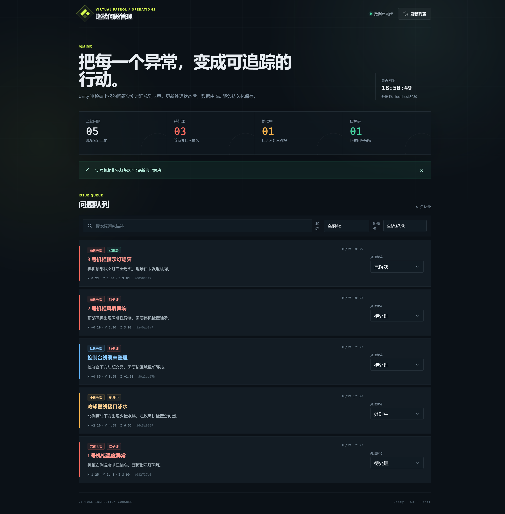

# 虚拟现场巡检问题标注

这是一个面向园区、厂房或机房巡检场景的三端最小闭环项目：

```text
Unity 虚拟现场
  → 射线点击并放置标记
  → 填写并上报问题
  → Go 后端校验并持久化
  → React 管理端查看问题、修改状态
  → 重启后端后数据仍然存在
```

本项目为“无 AR 设备备选版”，不依赖手机、ARCore 或 ARKit。



## 使用版本

| 部分 | 版本 |
|---|---|
| Unity | 2022.3.44f1 LTS |
| Go | 1.23.4；源码兼容 Go 1.22+ |
| Node.js | 24.13.1 |
| React / React DOM | 19.3.1 |
| TypeScript | 7.0.2 |
| Vite | 8.3.5 |

Unity 只使用基础几何体和内置 UGUI，不依赖付费资源。为显示中文，客户端优先使用操作系统中的微软雅黑、苹方或 Arial 动态字体。

## 目录

```text
.
├── unity/VirtualInspection/   Unity 客户端
├── backend/                   Go API 与 JSON 持久化
├── frontend/                  React + TypeScript 管理端
├── README.md
└── AI_LOG.md
```

## 启动方式

### 1. 启动 Go 后端

安装 Go 1.22+ 后，在项目根目录运行：

```powershell
cd backend
go run ./cmd/server
```

默认监听 `http://localhost:8080`，数据写入 `backend/data/issues.json`。

可选环境变量：

```powershell
$env:ADDR = "127.0.0.1:8080"
$env:DATA_FILE = "D:\inspection-data\issues.json"
go run ./cmd/server
```

### 2. 启动 React 管理端

```powershell
cd frontend
npm ci
npm run dev
```

浏览器访问 `http://127.0.0.1:5173`。

开发模式下，Vite 会把 `/api` 和 `/health` 代理到 `http://127.0.0.1:8080`。如需让浏览器直接访问其他后端地址，可设置：

```powershell
$env:VITE_API_BASE_URL = "http://localhost:8080/api"
npm run dev
```

Go 服务会返回 CORS 响应头，允许 React 页面直接访问 API。

### 3. 打开 Unity 客户端

1. 使用 Unity Hub 安装 Unity 2022.3 LTS。
2. 在 Unity Hub 中选择“Add project from disk”，打开 `unity/VirtualInspection`。
3. 等待首次导入完成，打开 `Assets/Scenes/InspectionScene.unity`。
4. 保持 Go 后端运行，点击 Play。

场景也可以通过菜单 `Virtual Inspection > Open Inspection Scene` 重新打开。

操作方式：

- `W/A/S/D`：平面移动；
- 按住鼠标右键拖动：转动视角；
- 鼠标左键点击设备或场景表面：在实际命中位置创建问题标记；
- 填写标题、可选描述和优先级后提交；
- 点击“取消填写”或按 `Esc`：关闭表单并移除未保存标记；
- 点击已保存标记：查看问题详情；
- 已保存标记颜色：红色 `open`、黄色 `in_progress`、绿色 `resolved`。

Unity 默认请求 `http://localhost:8080/api`。如后端地址不同，在启动 Unity 前设置：

```powershell
$env:INSPECTION_API_URL = "http://127.0.0.1:8080/api"
```

## 接口设计

| 方法 | 路径 | 说明 | 成功响应 |
|---|---|---|---|
| `GET` | `/health` | 服务状态检查 | `200 {"status":"ok","time":"..."}` |
| `GET` | `/api/issues` | 获取全部问题，最新上报在前 | `200 {"issues":[...]}` |
| `POST` | `/api/issues` | 创建问题 | `201` 完整问题对象 |
| `PATCH` | `/api/issues/{id}/status` | 修改处理状态 | `200` 完整问题对象 |

创建问题请求：

```json
{
  "title": "1 号机柜温度异常",
  "description": "机柜右侧温度明显偏高",
  "priority": "high",
  "position": {
    "x": 1.25,
    "y": 0.8,
    "z": 2.4
  }
}
```

修改状态请求：

```json
{
  "status": "in_progress"
}
```

枚举值：

- `priority`: `low`、`medium`、`high`；
- `status`: `open`、`in_progress`、`resolved`。

后端生成 `id`、`createdAt`、`updatedAt`，新问题默认状态为 `open`。参数错误统一返回：

```json
{
  "error": "明确的中文错误说明"
}
```

完整问题字段：

```json
{
  "id": "由后端生成",
  "title": "1 号机柜温度异常",
  "description": "机柜右侧温度明显偏高",
  "priority": "high",
  "status": "open",
  "position": {
    "x": 1.25,
    "y": 0.8,
    "z": 2.4
  },
  "createdAt": "由后端生成",
  "updatedAt": "由后端生成"
}
```

## 已实现

- Unity 使用地面、墙面、3 个机柜、控制台、管线等基础对象搭建虚拟巡检现场；
- Unity 支持 WASD 移动和右键拖动视角；
- Unity 使用 `Physics.Raycast` 从鼠标位置检测实际命中点；
- 标记位置取射线命中点，不取设备中心；
- 表单打开、提交中或详情打开时不处理场景点击；
- 使用 `EventSystem.current.IsPointerOverGameObject()` 隔离按钮和输入框点击；
- 同一时间最多存在一个未保存标记；
- 取消填写会销毁未保存标记；
- 提交失败时保留待提交标记，允许在原位置重试；
- 提交成功后创建已保存标记；
- Unity 启动时从后端恢复问题标记，并按状态着色；
- 点击已保存标记可查看标题、描述、优先级、状态和坐标；
- React 显示标题、优先级、状态、描述、坐标和上报时间；
- React 支持搜索、状态/优先级筛选和三种状态修改；
- React 后端不可用时显示可恢复错误页，不白屏；
- React 增加顶层 Error Boundary；
- Go 提供健康检查、创建、列表和状态修改接口；
- Go 校验空标题、枚举错误、字符数和不存在的问题；
- Go 使用临时文件替换方式保存 JSON，重启后数据仍存在。

## 测试

### Go

```powershell
cd backend
go test ./...
```

测试覆盖：

- 创建、列表、状态更新；
- 标题、优先级、状态参数错误；
- JSON 重新加载后的状态持久化；
- 健康检查和 CORS 预检。

真实进程级联调可以运行：

```powershell
.\scripts\verify_backend.ps1
```

该脚本会编译 Go 服务、使用临时端口和数据文件，验证健康检查、参数错误、CORS、创建、修改状态，并停止和重启服务确认数据持久化。

### React

```powershell
cd frontend
npm test
npm run build
```

已通过的验证：

- `go test ./...`：全部通过；
- `npm test`：问题加载、状态更新和后端不可用错误态共 2 项测试通过；
- `npm run build`：TypeScript 类型检查与 Vite 生产构建通过。
- Unity 运行时代码已使用 Unity 2021.3 模块引用和 UGUI 引用完成 C# 静态编译检查；这不能替代 Unity 2022.3 Editor 的实际导入与场景验证。

## 未完成与已知问题

- 当前开发机器未完成已授权 Unity Editor 的打开和 Play Mode 验证，因此尚未确认场景视觉表现与实际输入操作；
- 题目要求的两段 3～5 分钟演示视频尚未录制；
- 本项目按无 AR 设备版实现，没有引入 AR Foundation 或 XR Simulation；
- Unity 使用固定虚拟场景坐标，不包含真实空间锚点；
- JSON 文件持久化适合单实例本地运行，不适合多实例并发部署；
- Unity 默认面向 Windows 桌面运行，未制作独立安装包。

在录制演示和提交评审前，必须先在已授权 Unity Editor 中打开工程、确认 Console 无编译错误，并完成一次从 Unity 上报到 React 修改状态、再重启 Go 验证持久化的完整演示。

## AR 基础理解

### 1. 平面对点击放置通常使用哪些 AR Foundation 能力？

通常使用 `AR Session` 维持会话，`XR Origin` 作为设备空间中的原点，`AR Plane Manager` 检测平面。点击时把屏幕点击位置转换为射线，通过 `ARRaycastManager` 检测平面，或者在 AR Raycast 不足时使用 `ARPlaneManager` 的平面交点，再在命中姿态实例化标记。实际项目还应处理平面边界、遮挡和命中失败。

### 2. 为什么只保存 Unity 的 x/y/z 通常不能恢复同一真实位置？

Unity 世界坐标依赖本次运行的跟踪原点。真实 AR 的 Session Origin、设备姿态、场景特征和空间锚点会变化；下次启动时原点可能不同，甚至可能进入没有足够特征定位的新环境。因此同样 x/y/z 不再保证对应同一个真实位置。需要持久化空间锚点、场所地图或经过重定位的锚点数据，并处理恢复失败。

### 3. AR 初始化失败、设备不支持或 Tracking 异常时如何提示？

应用应停止放置和提交空间标记，明确显示具体状态，例如“设备不支持 AR”“相机权限未开启”“正在寻找平面”“空间跟踪中断”。可以提供“重试”“打开权限设置”“重新扫描环境”或“切换普通模式”等操作，并在界面中标记当前已有标记位置可能不准确，不能静默失败或继续伪报成功。
