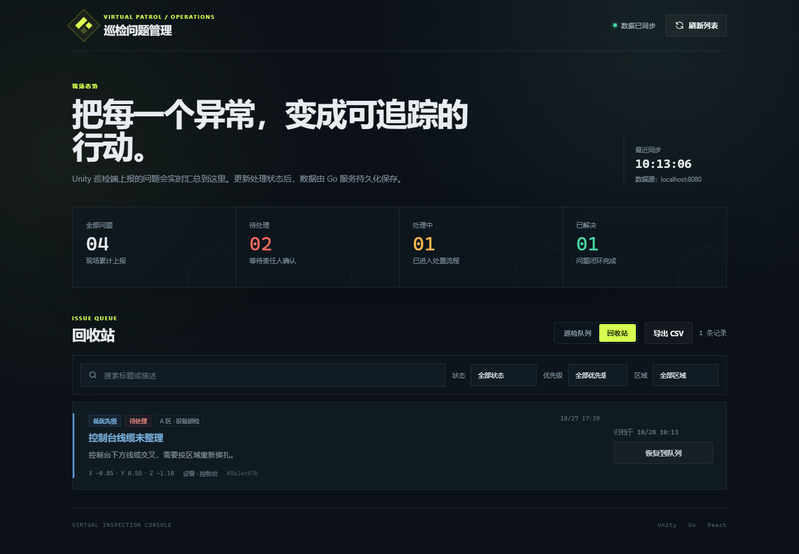
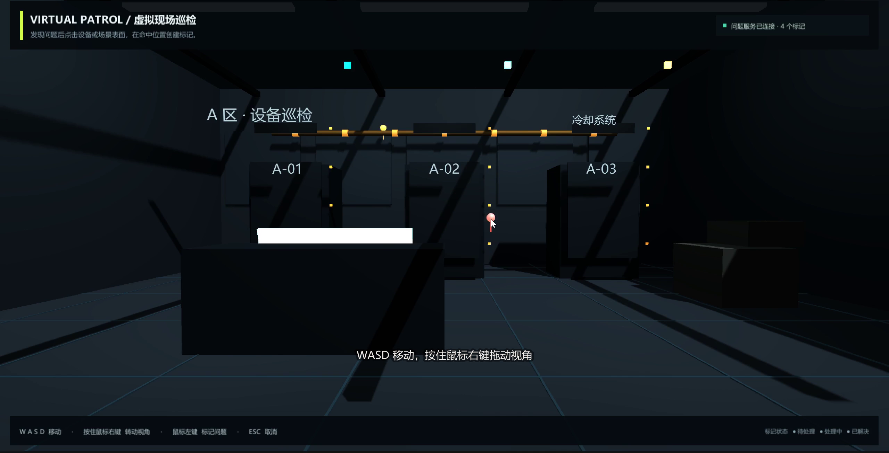
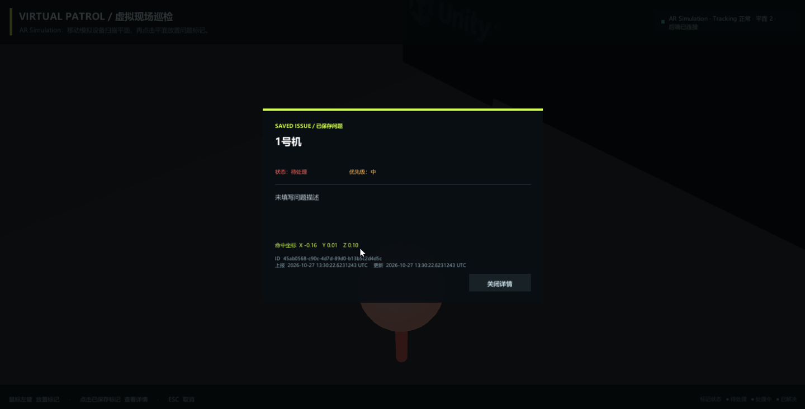

# 虚拟现场巡检问题标注

这是一个面向园区、厂房或机房巡检场景的三端最小闭环项目：

```text
Unity 虚拟现场
  → 射线点击并放置标记
  → 填写并上报问题
  → Go 后端校验并持久化
  → React 管理端查看问题、修改状态
  → 重启后端后数据仍然存在
```

本项目为“无 AR 设备备选版”，不依赖手机、ARCore 或 ARKit。




## 使用版本

| 部分 | 版本 |
|---|---|
| Unity | 2022.3.44f1c1 LTS（Unity China 发行版） |
| Go | 1.23.4；源码兼容 Go 1.22+ |
| Node.js | 24.13.1 |
| React / React DOM | 19.3.1 |
| TypeScript | 7.0.2 |
| Vite | 8.3.5 |

Unity 只使用基础几何体和内置 UGUI，不依赖付费资源。为显示中文，客户端优先使用操作系统中的微软雅黑、苹方或 Arial 动态字体。

## 目录

```text
.
├── unity/VirtualInspection/   Unity 客户端
├── backend/                   Go API 与 JSON 持久化
├── frontend/                  React + TypeScript 管理端
├── deploy/                    Dockerfile 与 nginx 反向代理配置
├── docker-compose.yml         后端 + 管理端一键启动
├── demos/                     两段演示视频与字幕
├── README.md
└── AI_LOG.md
```

## 启动方式

### 1. 启动 Go 后端

安装 Go 1.22+ 后，在项目根目录运行：

```powershell
cd backend
go run ./cmd/server
```

默认监听 `http://localhost:8080`，数据写入 `backend/data/issues.json`。

可选环境变量：

```powershell
$env:ADDR = "127.0.0.1:8080"
$env:DATA_FILE = "D:\inspection-data\issues.json"
go run ./cmd/server
```

### 2. 启动 React 管理端

```powershell
cd frontend
npm ci
npm run dev
```

浏览器访问 `http://127.0.0.1:5173`。

开发模式下，Vite 会把 `/api` 和 `/health` 代理到 `http://127.0.0.1:8080`。如需让浏览器直接访问其他后端地址，可设置：

```powershell
$env:VITE_API_BASE_URL = "http://localhost:8080/api"
npm run dev
```

Go 服务会返回 CORS 响应头，允许 React 页面直接访问 API。

### 3. 打开 Unity 客户端

1. 使用 Unity Hub 安装 Unity 2022.3 LTS。
2. 在 Unity Hub 中选择“Add project from disk”，打开 `unity/VirtualInspection`。
3. 等待首次导入完成，打开 `Assets/Scenes/InspectionScene.unity`。
4. 保持 Go 后端运行，点击 Play。



场景也可以通过菜单 `Virtual Inspection > Open Inspection Scene` 重新打开。

操作方式：

- `W/A/S/D`：平面移动；
- 按住鼠标右键拖动：转动视角；
- 鼠标左键点击设备或场景表面：在实际命中位置创建问题标记；
- 填写标题、可选描述和优先级后提交；
- 点击“取消填写”或按 `Esc`：关闭表单并移除未保存标记；
- 点击已保存标记：查看问题详情；
- 已保存标记颜色：红色 `open`、黄色 `in_progress`、绿色 `resolved`；
- 已保存标记形态随优先级变化：`high` 头部最大（0.32）、立柱最高、额外带一层半透明光晕且脉动更快，`low` 最小最矮、几乎静止，`medium` 居中——这样不点开详情也能在场景里一眼看出哪条更紧急。

场景里的每台设备都带区域归属（`A 区 · 设备巡检`、`B 区 · 冷却系统`），点击时会把区域和设备名一起写进问题记录，管理端据此按区域筛选。

Unity 默认请求 `http://localhost:8080/api`。如后端地址不同，在启动 Unity 前设置：

```powershell
$env:INSPECTION_API_URL = "http://127.0.0.1:8080/api"
```

### 4. 用 Docker Compose 一键启动（可选）

如果本机装了 Docker Desktop，可以不装 Node 和 Go，直接起后端 + 管理端：

```powershell
docker compose up --build
```

启动后：

- 管理端：`http://127.0.0.1:5173`（nginx 托管构建产物，`/api`、`/health` 反向代理到后端容器）；
- 后端：`http://127.0.0.1:8080`（Unity 客户端可用这个地址）；
- 数据保存在命名卷 `inspection-data` 的 `/data/issues.json` 里，`docker compose down` 不会丢，`docker compose down -v` 才会清空。

两个镜像都在容器内构建（`deploy/Dockerfile.backend`、`deploy/Dockerfile.frontend`），管理端不依赖宿主机 `node_modules`。

### 5. AR 版本（AR Foundation XR Simulation，加分项）

题目第 8 节提到“用 AR Foundation XR Simulation 展示向 AR 版本迁移的思路”，这里做了一个能在编辑器里跑通的 AR 版本，和桌面版共用同一个 Go 后端与同一份数据。

1. 打开 `unity/VirtualInspection` 工程（AR Foundation、ARCore/ARKit、XR Simulation 相关包已在 `Packages/manifest.json` 里）；
2. 打开 `Assets/Scenes/ARSimulationScene.unity`；
3. 保持 Go 后端运行，点击 Play；Game 视图里出现的是 XR Simulation 的模拟环境（可用 `XR Simulation` 面板切换环境、调整模拟设备位置）；
4. 移动模拟设备扫描平面，检测到平面后点击平面放置标记，填写并提交，和管理端看到的数据完全一致。



实现要点：

- `ARSession` + `XR Origin` + `ARPlaneManager` 负责会话、原点和平面检测；
- 点击时用 `ARRaycastManager.Raycast` 在已检测平面上取命中姿态，标记落在 `hit.pose.position`；
- 后端不可达、Tracking 状态异常、没有检测到平面时，顶部状态条会给出对应提示，不会静默失败；
- 启动后同样从后端拉取历史问题，已在队列里的问题会恢复到对应位置；
- 因为没有真机，`Assets/Editor/ARSimulationProjectSetup.cs` 提供了一键配置菜单（`Virtual Inspection > Configure AR Simulation`）。

> 说明：这一版只在 XR Simulation 里验证过，没有在真实手机上跑过；主交付仍是题目允许的“无 AR 设备备选版”（桌面 Play Mode）。

## 接口设计

| 方法 | 路径 | 说明 | 成功响应 |
|---|---|---|---|
| `GET` | `/health` | 服务状态检查 | `200 {"status":"ok","time":"..."}` |
| `GET` | `/api/issues` | 获取巡检队列（不含已归档），最新上报在前 | `200 {"issues":[...]}` |
| `GET` | `/api/issues?deleted=1` | 获取回收站里的已归档问题 | `200 {"issues":[...]}` |
| `POST` | `/api/issues` | 创建问题 | `201` 完整问题对象 |
| `PATCH` | `/api/issues/{id}/status` | 修改处理状态 | `200` 完整问题对象 |
| `DELETE` | `/api/issues/{id}` | 移入回收站（软删除，数据仍在 JSON 里） | `204` 无响应体 |
| `POST` | `/api/issues/{id}/restore` | 从回收站恢复到巡检队列 | `200` 完整问题对象 |

创建问题请求：

```json
{
  "title": "1 号机柜温度异常",
  "description": "机柜右侧温度明显偏高",
  "priority": "high",
  "area": "A 区 · 设备巡检",
  "asset": "1 号机柜",
  "position": {
    "x": 1.25,
    "y": 0.8,
    "z": 2.4
  }
}
```

修改状态请求：

```json
{
  "status": "in_progress"
}
```

枚举值：

- `priority`: `low`、`medium`、`high`；
- `status`: `open`、`in_progress`、`resolved`。

`area`（区域）和 `asset`（设备名）是可选的归属信息，各不超过 64 个字符；Unity 端点击时自动带出，管理端用于按区域筛选与展示。老数据缺少这两个字段时，后端按空串处理，管理端显示“未归属区域 / 设备未登记”。

删除采用软删除：`DELETE /api/issues/{id}` 只写入 `deletedAt` 归档时间，记录仍留在 JSON 文件里，默认列表不再返回它；`?deleted=1` 才返回回收站内容，`POST /api/issues/{id}/restore` 清空 `deletedAt` 把它放回队列。已归档的问题不允许再改状态（返回 404），避免误操作回收站里的记录。

后端生成 `id`、`createdAt`、`updatedAt`，新问题默认状态为 `open`。参数错误统一返回：

```json
{
  "error": "明确的中文错误说明"
}
```

完整问题字段：

```json
{
  "id": "由后端生成",
  "title": "1 号机柜温度异常",
  "description": "机柜右侧温度明显偏高",
  "priority": "high",
  "status": "open",
  "area": "A 区 · 设备巡检",
  "asset": "1 号机柜",
  "position": {
    "x": 1.25,
    "y": 0.8,
    "z": 2.4
  },
  "createdAt": "由后端生成",
  "updatedAt": "由后端生成",
  "deletedAt": "归档时间，未归档时不出现该字段"
}
```

## 已实现

- Unity 使用地面、墙面、3 个机柜、控制台、管线等基础对象搭建虚拟巡检现场；
- Unity 支持 WASD 移动和右键拖动视角；
- Unity 使用 `Physics.Raycast` 从鼠标位置检测实际命中点；
- 标记位置取射线命中点，不取设备中心；
- 标记放在内置 `Ignore Raycast` 层，射线不会被标记自身挡住，落点始终是真实表面；点选已保存标记查看详情时，单独对标记层做一次射线；
- 表单打开、提交中或详情打开时不处理场景点击；
- 使用 `EventSystem.current.IsPointerOverGameObject()` 隔离按钮和输入框点击；
- 同一时间最多存在一个未保存标记；
- 取消填写会销毁未保存标记；
- 提交失败时保留待提交标记，允许在原位置重试；
- 提交成功后创建已保存标记；
- Unity 启动时从后端恢复问题标记，并按状态着色；
- 点击已保存标记可查看标题、描述、优先级、状态、坐标、区域与设备名；
- 标记形态随优先级变化：高优先级标记更大、立柱更高、外圈多一层半透明光晕且脉动更明显，低优先级最矮最小、几乎不脉动；
- Unity 场景中的每台设备/表面都带区域归属，上报时自动填入 `area`/`asset`；
- React 显示标题、优先级、状态、描述、坐标、区域、设备名和上报时间；
- React 支持搜索、状态/优先级/区域筛选和三种状态修改；
- React 支持删除问题，删除前需要二次确认；删除后进入“回收站”页签，可一键恢复到巡检队列；
- React 支持把当前筛选结果导出为 CSV（UTF-8 BOM，Excel 直接打开不乱码）；
- React 后端不可用时显示可恢复错误页，不白屏；
- React 增加顶层 Error Boundary；
- Go 提供健康检查、创建、列表、状态修改、软删除和恢复接口；
- Go 校验空标题、枚举错误、字符数、区域/设备名长度和不存在的问题；
- Go 使用临时文件替换方式保存 JSON，重启后数据仍存在；
- 提供 `docker-compose.yml`，一条命令起后端 + 管理端（nginx 反向代理，数据落命名卷）；
- 额外做了一个 AR Foundation XR Simulation 版本（`Assets/Scenes/ARSimulationScene.unity`）：`ARSession`/`XR Origin`/`ARPlaneManager` 检测平面，`ARRaycastManager` 命中平面后放置标记，与桌面版共用后端和 UI。

## 演示视频

| 演示 | 时长 | 内容 |
|---|---|---|
| [01-unity-playmode.mp4](demos/01-unity-playmode.mp4) | 3 分 20 秒 | Unity Play Mode、移动和转向、射线命中、标记、空标题校验、取消、填写并提交 |
| [02-react-management.mp4](demos/02-react-management.mp4) | 3 分 15 秒 | React 刷新、修改状态、Go 停止错误提示、Go 重启后持久化、改为已解决 |
| [03-admin-recycle-csv.mp4](demos/03-admin-recycle-csv.mp4) | 20 秒 | 加分项功能预览：软删除 → 回收站 → 恢复到队列 → 导出 CSV → 按区域筛选 |

两段视频均为 H.264、30 FPS，并带有中文步骤字幕。对应字幕文件位于 `demos/*.srt`。

> 说明：本作是题目中的“无 AR 设备备选版”，两段视频是在 Unity Editor 的 Play Mode 中录制的，不是真机 AR 录屏（题目允许 Editor 或普通桌面设备运行，不要求手机）。题目第 7 节列出的操作项均已覆盖：移动观察、点击放置标记、填写提交、React 刷新可见、修改状态、Go 重启后数据仍存在。

## 测试

### Go

```powershell
cd backend
go test ./...
```

测试覆盖：

- 创建、列表、状态更新、软删除、回收站列表与恢复；
- 标题、优先级、状态、区域/设备名参数错误；
- JSON 重新加载后的状态持久化（含删除后重新打开存储、恢复后重新打开存储）；
- 已归档问题不允许修改状态；
- 健康检查和 CORS 预检。

真实进程级联调可以运行：

```powershell
.\scripts\verify_backend.ps1
```

该脚本会编译 Go 服务、使用临时端口和数据文件，验证健康检查、参数错误、CORS、创建、修改状态，并停止和重启服务确认数据持久化。

### React

```powershell
cd frontend
npm test
npm run build
```

已通过的验证：

- `go test ./...`：全部通过；
- `npm test`：后端不可用错误态、后端返回格式异常、问题加载与状态更新、删除二次确认、回收站恢复、CSV 导出共 6 项测试通过；
- `npm run build`：TypeScript 类型检查与 Vite 生产构建通过；
- `docker compose config`：Compose 配置解析通过（本机未启动 Docker 守护进程，未实际构建镜像）；
- Unity 2022.3.44f1c1 已实际打开工程、完成脚本编译并进入 Play Mode；
- Unity 已实际完成射线命中、表单校验、取消清理、问题提交、已保存标记恢复、标记详情和按优先级变化的标记形态；
- 接口级联调已实测：创建 → 软删除（默认列表消失）→ `?deleted=1` 可见且带 `deletedAt` → 改状态返回 404 → 恢复后回到队列；
- 已录制并抽帧检查两段 3～5 分钟演示视频。

## 未完成与已知问题

- 主交付按无 AR 设备备选版实现（桌面 Play Mode）；另外附了一个 AR Foundation XR Simulation 版本，但只在编辑器模拟环境里验证过，没有在真实手机上运行，也没有做真机空间锚点持久化；
- Unity 使用固定虚拟场景坐标，不包含真实空间锚点；
- JSON 文件持久化适合单实例本地运行，不适合多实例并发部署；
- Docker 镜像只在本机做了配置校验，尚未在启用了 Docker Desktop 的机器上实跑；
- 删除是软删除，数据不会真删；回收站里的记录只能恢复，没有“彻底删除”入口；
- 没有操作留痕（谁在什么时候改了状态），多人协作时无法追溯；
- Unity 默认面向 Windows 桌面运行，未制作独立安装包。

仓库内 `backend/data/issues.json` 保留了演示时生成的 5 条问题记录，便于评审打开后直接看到数据。若需要空库，将文件内容改为 `[]` 后重启 Go 服务即可。

## AR 基础理解

### 1. 平面对点击放置通常使用哪些 AR Foundation 能力？

通常使用 `AR Session` 维持会话，`XR Origin` 作为设备空间中的原点，`AR Plane Manager` 检测平面。点击时把屏幕点击位置转换为射线，通过 `ARRaycastManager` 检测平面，或者在 AR Raycast 不足时使用 `ARPlaneManager` 的平面交点，再在命中姿态实例化标记。实际项目还应处理平面边界、遮挡和命中失败。

### 2. 为什么只保存 Unity 的 x/y/z 通常不能恢复同一真实位置？

Unity 世界坐标依赖本次运行的跟踪原点。真实 AR 的 Session Origin、设备姿态、场景特征和空间锚点会变化；下次启动时原点可能不同，甚至可能进入没有足够特征定位的新环境。因此同样 x/y/z 不再保证对应同一个真实位置。需要持久化空间锚点、场所地图或经过重定位的锚点数据，并处理恢复失败。

### 3. AR 初始化失败、设备不支持或 Tracking 异常时如何提示？

应用应停止放置和提交空间标记，明确显示具体状态，例如“设备不支持 AR”“相机权限未开启”“正在寻找平面”“空间跟踪中断”。可以提供“重试”“打开权限设置”“重新扫描环境”或“切换普通模式”等操作，并在界面中标记当前已有标记位置可能不准确，不能静默失败或继续伪报成功。
